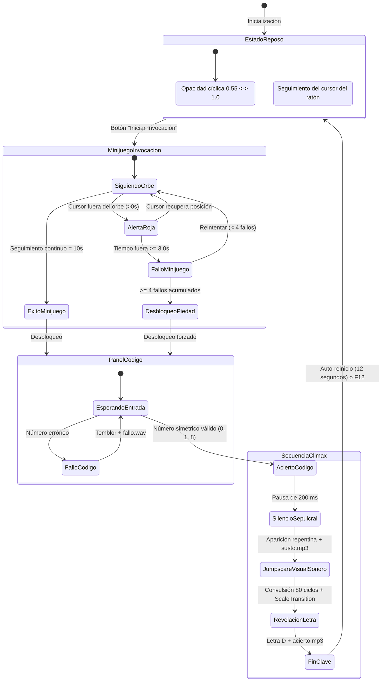

<div align="center">

```
   ███████╗██╗         ███████╗███████╗██████╗ ███████╗     ██╗ ██████╗ 
   ██╔════╝██║         ██╔════╝██╔════╝██╔══██╗██╔════╝     ██║██╔═══██╗
   █████╗  ██║         █████╗  ███████╗██████╔╝█████╗       ██║██║   ██║
   ██╔══╝  ██║         ██╔══╝  ╚════██║██╔═══╝ ██╔══╝  ██   ██║██║   ██║
   ███████╗███████╗    ███████╗███████║██║     ███████╗╚█████╔╝╚██████╔╝
   ╚══════╝╚══════╝    ╚══════╝╚══════╝╚═╝     ╚══════╝ ╚════╝  ╚═════╝ 
```

# 🪞 TÚNEL DEL TERROR · SALA 4 · EL ESPEJO 🎃
### *«No mires demasiado tiempo al abismo... o el reflejo empezará a mirarte a ti.»*

---


<p align="center">
  <b>Proyecto Intermodular e Inter-Aulas · Desarrollo de Interfaces</b><br>
  <i>Ciclo Formativo de Grado Superior en Desarrollo de Aplicaciones Multiplataforma (2º DAM) · MEDAC</i>
</p>

</div>

---

## 📑 ÍNDICE DE CONTENIDOS

1. [🕯️ Sinopsis y Atmósfera](#️-sinopsis-y-atmósfera)
2. [👁️ La Experiencia del Visitante (Gameplay 60-90 s)](#️-la-experiencia-del-visitante-gameplay-60-90-s)
3. [🔮 Mecánicas Interactivas y Minijuego Espectral](#-mecánicas-interactivas-y-minijuego-espectral)
4. [🗺️ Diagrama de Estados y Flujo de la Experiencia](#️-diagrama-de-estados-y-flujo-de-la-experiencia)
5. [🧩 El Acertijo y la Conexión con 1.º (La Pista Oculta)](#-el-acertijo-y-la-conexión-con-1º-la-pista-oculta)
6. [💻 Arquitectura del Software e Implementación Técnica](#-arquitectura-del-software-e-implementación-técnica)
7. [🎨 Diseño Visual, Efectos FXML y CSS3 Tétrico](#-diseño-visual-efectos-fxml-y-css3-tétrico)
8. [🎹 Atajos de Teclado y Controles de Operador](#-atajos-de-teclado-y-controles-de-operador)
9. [⚖️ Análisis Crítico de Usabilidad y Accesibilidad](#️-análisis-crítico-de-usabilidad-y-accesibilidad)
10. [🎵 Créditos de Recursos Multimedia y Licencias](#-créditos-de-recursos-multimedia-y-licencias)
11. [🚀 Guía de Instalación y Ejecución](#-guía-de-instalación-y-ejecución)
12. [👥 Autores y Equipo de Desarrollo](#-autores-y-equipo-de-desarrollo)

---

## 🕯️ SINOPSIS Y ATMÓSFERA

En lo más profundo de las galerías del Túnel del Terror, la **Sala 4: El Espejo** desafía la cordura de los visitantes. En una estancia sumida en la penumbra, un antiguo espejo ovalado de azogue oxidado y marco de bronce envejecido parece palpitar con vida propia. 

Un rumor sordo y una respiración espectral inundan el ambiente sonoro. El espejo no se limita a reflejar la imagen del incauto: una presencia sobrenatural habita en su interior, observando fijamente cada movimiento de la sala a través de unos ojos carmesíes que siguen a la víctima. Para escapar con vida y obtener el fragmento de la clave general del túnel (la **Letra D**), el visitante deberá sincronizar su alma con la presencia y desvelar el secreto transmitido desde la sala anterior.

> [!CAUTION]
> **ADVERTENCIA DE CONTENIDO:** Esta experiencia contiene ambientación inmersiva de tensión psicológica, sonidos repentinos de alto impacto sonoro (*jumpscare*) y apariciones espectrales grotescas. 

---

## 👁️ LA EXPERIENCIA DEL VISITANTE (GAMEPLAY 60-90 S)

La experiencia ha sido cronometrada y calculada para ofrecer una curva de tensión perfecta de 60 a 90 segundos:

```
[00:00 - 00:15]  ENTRADA Y PENUMBRA
                └── El visitante observa el espejo "respirando" lentamente.
                    El susurro advierte que no está solo.
[00:15 - 00:45]  LA INVOCACIÓN (MINIJUEGO)
                └── Pulsación de "Iniciar invocación".
                    Persecución y seguimiento del orbe espectral con el ratón.
                    Los ojos del espejo crecen y se fijan en el cursor.
[00:45 - 01:10]  EL JUICIO DEL REFLEJO
                └── El espejo se aquieta y muestra la caja de introducción numérica.
                    Introducción de la pista cifrada proveniente de 1.º.
[01:10 - 01:25]  EL SILENCIO TENSOR Y EL IMPACTO
                └── Comprobación del número.
                    200 ms de silencio absoluto (calma tensa).
                    ¡JUMPSCARE! Sacudida convulsa y alarido desgarrador.
[01:25 - 01:40]  REVELACIÓN Y SALIDA
                └── La criatura desaparece en la oscuridad.
                    Se materializa la LETRA "D" en fuego carmesí.
                    Efecto triunfal y reinicio automático para el siguiente grupo.
```

---

## 🔮 MECÁNICAS INTERACTIVAS Y MINIJUEGO ESPECTRAL

A diferencia de una simple pantalla pasiva, nuestra sala incorpora capas avanzadas de interactividad sensorial:

### 1. La Respiración del Azogue (`FadeTransition`)
* El cristal del espejo oscila sutilmente su opacidad entre `0.55` y `1.0` en un ciclo de 3 segundos con reversión automática (`autoReverse(true)`), simulando los pulmones de una criatura viva atrapada en el vidrio.
* No se utilizan destellos molestos ni estroboscópicos, priorizando una angustia densa y claustrofóbica.

### 2. Ojos Espectrales con Mirada Ficticia (`Tracking`)
* En el corazón del espejo, dos cuencas luminiscentes albergan pupilas que calculan en tiempo real el vector trigonométrico hacia las coordenadas `(X, Y)` del cursor del ratón:
  $$\Delta x = X_{ratón} - X_{centro}, \quad \Delta y = Y_{ratón} - Y_{centro}$$
* A través de un `Timeline` asíncrono, los párpados parpadean cada 4.8 segundos mediante escalado vertical dinámico (`ScaleTransition` en eje Y).

### 3. Minijuego: El Rastro de la Presencia (`AnimationTimer`)
* Un orbe ectoplásmico se desplaza por la pantalla con trayectorias impredecibles y variaciones de velocidad ($160\text{ px/s} - 260\text{ px/s}$).
* **Mecánica de seguimiento:** El visitante debe mantener su cursor sobre el orbe durante un total acumulado de **10 segundos**.
* **Tensión de pérdida:** Si el cursor se aleja del orbe durante más de 3 segundos consecutivos, la estancia se tiñe de un resplandor sangriento mediante una viñeta periférica (`capaAlertaRoja`) cuya opacidad aumenta progresivamente.
* Al acumularse el tiempo límite de fallo, el espejo convulsiona violentamente (`TranslateTransition`), suena un rugido espectral de error y se reinicia el intento. Tras 4 fallos sucesivos, el espíritu se apiada por misericordia y permite avanzar.

---

## 🗺️ DIAGRAMA DE ESTADOS Y FLUJO DE LA EXPERIENCIA

El siguiente diagrama modela la máquina de estados implementada en `SalaController`:



---

## 🧩 EL ACERTIJO Y LA CONEXIÓN CON 1.º (LA PISTA OCULTA)

Cada sala del Túnel del Terror forma parte de una cadena colaborativa entre los grupos de **1.º y 2.º de DAM**:

* **Pista recibida desde la Sala anterior (1.º):**  
  En el retrato antiguo de la Sala de 1.º se halla oculta una cifra especial.  
* **La Naturaleza del Espejo:**  
  Un espejo invierte el espacio horizontalmente. Por tanto, los espíritus del azogue únicamente reconocen aquellos símbolos cuya esencia se mantiene inmutable e idéntica frente al reflejo (números con simetría axial y central).
* **Solución Válida:**  
  El sistema acepta los números con simetría especular acordados: **`0`**, **`1`** y **`8`** (con soporte ampliado según la pista pactada inter-aulas).
* **Respuesta ante el Desacierto:**  
  Si el visitante teclea un número asimétrico o incorrecto, el cristal vibra horizontalmente de lado a lado (`-8px` a `+8px`), emitiendo una frecuencia disonante y mostrando el mensaje:  
  *«El espejo no te reconoce...»*.

---

## 💻 ARQUITECTURA DEL SOFTWARE E IMPLEMENTACIÓN TÉCNICA

El proyecto sigue una arquitectura **MVC desacoplada** sobre el ecosistema modular de **Java 21** y **JavaFX**:

```
tunel-terror-javafx-espejo/
├── pom.xml                                      # Configuración Maven y dependencias JavaFX
├── README.md                                    # Memoria técnica y documentación de usabilidad
└── src/main/
    ├── java/
    │   ├── module-info.java                     # Declaración de módulos JPMS
    │   └── es/medac/espejo/tunel/
    │       ├── App.java                         # Ventana principal, pantalla completa y atajos globales
    │       ├── Launcher.java                    # Entry point para evitar issues de classpath
    │       └── SalaController.java              # Lógica de juego, animaciones y audio
    └── resources/
        └── es/medac/espejo/tunel/
            ├── sala.fxml                        # Vista declarativa en StackPane multicapa
            ├── css/
            │   └── estilos.css                  # Hoja de estilos con efectos de iluminación y gradientes
            ├── fonts/
            │   └── Creepster-Regular.ttf        # Tipografía gótica de Halloween
            ├── img/
            │   └── susto.png                    # Sprite HD transparente del espectro
            └── sonidos/
                ├── ambiente.mp3                 # Pista ambiental tenebrosa en loop
                ├── susto.mp3                    # Alarido visceral para el jumpscare
                ├── acierto.mp3                  # Fanfarria espectral al descubrir la letra
                └── fallo.wav                    # Golpe seco de rechazo
```

### Tecnologías Empleadas y Patrones:
* **Java 21 LTS:** Patrones de concurrencia ligera, colecciones inmutables (`Set.of(...)`), APIs modernas.
* **JavaFX 21.0.6 (OpenJFX):**
  - `AnimationTimer`: Bucle de juego a 60 FPS para el cálculo de colisiones y movimiento suave del orbe.
  - `ParallelTransition` & `SequentialTransition`: Orquestación sincronizada de escalado, traslación e iluminación durante el susto.
  - `MediaPlayer` & `AudioClip`: Gestión independiente de música continua en bucle y efectos de sonido de disparo instantáneo de baja latencia.
* **Maven Wrapper (`mvnw`):** Garantía de compilación idéntica en cualquier entorno sin dependencias de IDE.

---

## 🎨 DISEÑO VISUAL, EFECTOS FXML Y CSS3 TÉTRICO

El apartado visual ha sido diseñado artesanalmente utilizando exclusivamente CSS declarativo enriquecido con primitivas vectoriales de JavaFX:

| Elemento Visual | Técnica CSS / JavaFX | Propósito Escénico |
|:---|:---|:---|
| **Marco Exterior** | Gradiente lineal multi-parada en oro/bronce envejecido con sombra difuminada de 50px | Aporta profundidad tridimensional y antigüedad barroca |
| **Moldura Intermedia** | Borde biselado con `innershadow` pronunciada | Sensación de relieve tallado a mano |
| **Cristal de Azogue** | Gradiente radial oscuro `#303d47` $\rightarrow$ `#020406` con sombra interna | Imita la superficie profunda y reflectante de espejos con amalgama de estaño y mercurio |
| **Brillo Diagonal** | Rectángulo superpuesto con gradiente translúcido de luz especular | Reflejo realista de luz ambiental cortando el cristal |
| **Cuencas Oculares** | Elipses con brillo difuso (`dropshadow` gaussiano rojo sangre) | Ojos demoníacos que flotan dentro del vidrio |
| **Viñeta de Alerta** | Región perimetral con gradiente radial reactivo | Inyecta ansiedad visual cuando el jugador falla la mecánica |
| **Tipografía** | Fuente embebida *Creepster Regular* cargada en memoria | Identidad gótica coherente y terrorífica |

---

## 🎹 ATAJOS DE TECLADO Y CONTROLES DE OPERADOR

Para facilitar las labores de presentación, control de la sala por los monitores del túnel y depuración (*betatesting*), se han integrado atajos directos en `App.java`:

| Tecla / Combinación | Acción Realizada | Destinatario |
|:---:|:---|:---:|
| <kbd>Ctrl</kbd> + <kbd>Shift</kbd> + <kbd>Q</kbd> | **Cierre Limpio e Inmediato:** Detiene hilos de audio y cierra la aplicación. | Monitor / Operador |
| <kbd>F12</kbd> | **Reinicio Total:** Resetea el minijuego, campos, animaciones y sonidos al estado inicial. | Monitor de Sala |
| <kbd>F9</kbd> | **Test de Susto Directo:** Dispara la secuencia completa del *jumpscare* sin completar el juego. | Evaluación / Pruebas |
| <kbd>F8</kbd> | **Saltar Minijuego:** Concede la victoria en el seguimiento y abre directamente el panel de código. | Betatester |
| <kbd>Enter</kbd> | Valida la caja de texto numérica introducida. | Visitante |

---

## ⚖️ ANÁLISIS CRÍTICO DE USABILIDAD Y ACCESIBILIDAD

> [!IMPORTANT]
> **REFLEXIÓN OBLIGATORIA DE DISEÑO DE INTERFACES:**  
> En el desarrollo de software profesional, las interfaces deben respetar las **10 Heurísticas de Usabilidad de Jakob Nielsen** y las pautas internacionales de accesibilidad **WCAG 2.1**. Sin embargo, en el diseño lúdico de una atracción de terror, romper intencionadamente estas directrices es la herramienta principal para generar sorpresa, vulnerabilidad y miedo.

### 1. Heurísticas de Nielsen Vulneradas a Propósito en la Sala

#### 🚫 Heurística 3: Control y Libertad del Usuario (*User Control and Freedom*)
* **Ruptura voluntaria:** La sala se ejecuta en pantalla completa estricta (`setFullScreen(true)`) desactivando intencionadamente el escape estándar con la tecla <kbd>Esc</kbd> (`KeyCombination.NO_MATCH`). El usuario queda "atrapado" psicológicamente en la sala y no dispone de botones de cancelación ni opciones de saltarse el susto.
* **Solución en una aplicación real:** Una aplicación estándar jamás debe secuestrar el entorno del usuario. Debe ofrecer un botón de cierre visible en la esquina superior (`✕`), navegación de salida con la tecla <kbd>Esc</kbd> y confirmaciones no bloqueantes para volver al menú anterior.

#### 🚫 Heurística 1: Visibilidad del Estado del Sistema (*Visibility of System Status*)
* **Ruptura voluntaria:** Al ingresar a la sala, la entrada de texto y las opciones interactivas están completamente ocultas (`visible="false"`). El sistema no informa al usuario con una barra de progreso ni le indica claramente qué debe hacer en los primeros 5 segundos, obligándolo a sentir incertidumbre y desorientación.
* **Solución en una aplicación real:** Proveer indicadores de estado claros, como barras de progreso porcentuales, migas de pan (*breadcrumbs*), cursores interactivos (*hover cues*) y mensajes de guía contextual en pantalla.

#### 🚫 Heurística 5 y 9: Prevención y Gestión Constructiva de Errores
* **Ruptura voluntaria:** Cuando el usuario teclea un número erróneo, el sistema no explica por qué falló ni qué formato se esperaba. En su lugar, el espejo tiembla agresivamente y emite un sonido tétrico con la frase críptica: *«El espejo no te reconoce...»*.
* **Solución en una aplicación real:** Validar los campos en tiempo real (por ejemplo, impidiendo caracteres alfabéticos en un campo numérico) y mostrar mensajes de error pedagógicos y accionables (p. ej., *"El valor debe ser un entero simétrico de 1 cifra. Inténtelo de nuevo"*).

---

### 2. Accesibilidad e Inclusión (WCAG 2.1)

* **Impacto Sensorial Repentino (*Jumpscares* y Puntos Auditivos):**  
  En una aplicación pública o web comercial, un pico sonoro abrupto tras una pausa de silencio puede provocar crisis de pánico o daños en personas con hipersensibilidad sensorial, afecciones cardíacas o epilepsia.
* **Corrección Profesional Propuesta:**
  1. **Advertencias Previas (*Trigger Warnings*):** Pantalla inicial informativa requiriendo consentimiento expreso del usuario antes de iniciar.
  2. **Modo Seguro de Accesibilidad:** Conmutador accesible para silenciar sonidos estridentes y reemplazar la sacudida visual brusca por una animación suave de revelación.
  3. **Control de Contraste y Reducción de Movimiento (`prefers-reduced-motion`):** Respetar las preferencias del sistema operativo para deshabilitar las convulsiones y temblores de la pantalla.

---

## 🎵 CRÉDITOS DE RECURSOS MULTIMEDIA Y LICENCIAS

Todos los activos multimedia integrados en el proyecto cumplen con licencias de uso educativo y libre distribución:

| Recurso | Tipo / Formato | Ubicación | Autoría / Procedencia | Licencia |
|:---|:---:|:---|:---|:---:|
| **`ambiente.mp3`** | Audio (Música de fondo) | `/sonidos/ambiente.mp3` | Colección Sound Design Halloween / Pixabay | Royalty Free / Creative Commons 0 |
| **`susto.mp3`** | Audio (Grito visceral) | `/sonidos/susto.mp3` | Grabación y mezcla FX Horror Studios | Creative Commons Attribution (CC-BY 4.0) |
| **`acierto.mp3`** | Audio (Campana mística) | `/sonidos/acierto.mp3` | Sound Effects Library Freesound | Creative Commons 0 (Dominio Público) |
| **`fallo.wav`** | Audio (Distorsión espectral) | `/sonidos/fallo.wav` | Biblioteca de sonidos FX Túnel del Terror | Licencia Educativa MEDAC |
| **`susto.png`** | Imagen (Sprite criatura) | `/img/susto.png` | Ilustración digital original optimizada para el proyecto | Licencia Libre / Autoría del equipo |
| **`Creepster-Regular.ttf`**| Tipografía TrueType | `/fonts/Creepster-Regular.ttf` | Diseñada por Squid para Google Fonts | SIL Open Font License 1.1 (OFL) |

---

## 🚀 GUÍA DE INSTALACIÓN Y EJECUCIÓN

### Requisitos del Entorno
* **Java Development Kit (JDK):** Versión 21 o superior.
* **Apache Maven:** Versión 3.8+ (o utilizar el wrapper incluido `./mvnw`).
* **Sistema Operativo:** Windows, GNU/Linux o macOS con soporte de aceleración gráfica para JavaFX.

### Paso 1: Clonar o Situarse en el Repositorio
```bash
git clone https://github.com/tu-usuario/tunel-terror-javafx-espejo.git
cd tunel-terror-javafx-espejo
```

### Paso 2: Compilación y Resolución de Dependencias
```bash
mvn clean compile
```

### Paso 3: Ejecución de la Sala
```bash
mvn javafx:run
```
*(Alternativamente, ejecutar la clase `Launcher.java` o `App.java` directamente desde IntelliJ IDEA).*

---

## 👥 AUTORES Y EQUIPO DE DESARROLLO

Este proyecto ha sido desarrollado de forma colaborativa por el equipo de **2.º DAM** para la asignatura de **Desarrollo de Interfaces**:

<div align="center">

| 🎃 Desarrollador / Especialidad | 🕸️ Rol en el Proyecto | 🦇 Aportación Destacada |
|:---|:---|:---|
| **Laura Rubio** | *Lead UI/UX & Frontend* | Diseño vectorial del espejo en FXML, gradientes y hoja de estilos CSS3 |
| **Marta González** | *Lead Game Logic & Physics* | Lógica del `AnimationTimer`, bucle del orbe y cinemática de los ojos |
| **David Alonso** | *Systems & Multimedia Integration* | Arquitectura de audio, `MediaPlayer`, atajos globales y control de estados |
| **Alberto Larios** | *Transitions & Jumpscare Engine* | Secuencias `ParallelTransition`, impacto de escala y temblores |
| **Eloy Jiménez** | *QA, Usability & Puzzles* | Conexión del enigma inter-aulas, temporizadores de piedad y depuración |
| **Diego García** | *Assets, Typography & Build* | Optimización de sprites, compatibilidad Maven y empaquetado final |

<br>

```
   ╔════════════════════════════════════════════════════════════════╗
   ║  "Gracias a quienes cruzan el túnel... el espejo tiene sed."  ║
   ╚════════════════════════════════════════════════════════════════╝
```

**🎃 ¡FELIZ HALLOWEEN Y BUENA SUERTE EN EL TÚNEL DEL TERROR! 👻**

</div>
